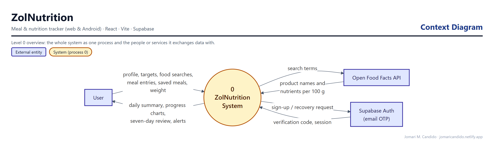
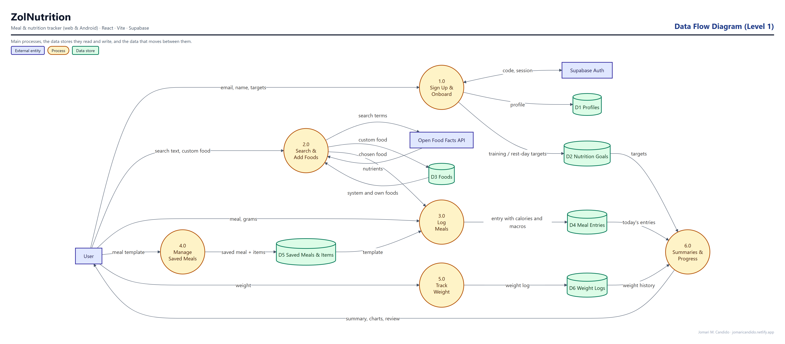
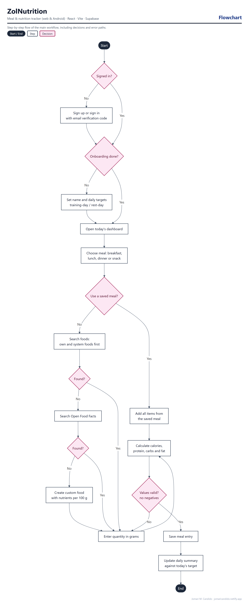

# ZolNutrition

**Meal & Nutrition Tracker (Web & Android)**

ZolNutrition is a calorie and macro tracker that shows your daily targets, what you have eaten, and what remains. It supports training-day and rest-day targets, saved meals, weight tracking, and a seven-day review, and runs on the web and as an Android app.

## Live Demo

**[Open ZolNutrition](https://zolnutrition.netlify.app/)**

## Highlights

- Email sign-up with OTP verification, password recovery, and three-step onboarding
- Daily calorie, protein, carbs, and fat targets with separate training-day and rest-day goals
- Food search across 4,882 USDA reference foods plus Open Food Facts packaged products
- One-tap repeat logging from recent and frequent foods, and reusable saved meals
- Five-second undo for deletes and copy-from-previous-day with duplicate guards
- Weight log and chart with target line and seven-weigh-in average
- Seven-day calorie review and progress summaries
- Android app built with Capacitor from the same source
- Dark theme, 44 px touch targets, keyboard-accessible dialogs, and reduced-motion support

## System design

These diagrams were drawn from the app's actual database schema, roles and code paths.

**Context diagram.** ZolNutrition as a single process, and the people and outside services it exchanges data with.



**Data flow diagram (Level 1).** The main processes, the data stores they read and write (grouped from the database tables), and the data that moves between them.



**Flowchart: logging a meal.** The main workflow step by step, including decisions and error paths.



## Tech Stack

- React 19, Vite 7, JavaScript
- Supabase Auth, PostgreSQL, and Row Level Security
- Open Food Facts API and a bundled USDA SR Legacy food catalog
- SweetAlert2
- Capacitor for Android
- Netlify

## Security Design

Every table is private to its owner through Row Level Security; shared system foods are read-only. Updates use `WITH CHECK` so rows cannot be moved to another account. Database check constraints reject negative nutrition values and impossible weights. Display names are for presentation only and are never used for authorization.

> Only the Supabase project URL and publishable key are used in the browser. Service-role keys, database passwords, and SMTP credentials must never be placed in Vite variables or committed to this repository.

## Database

The `supabase/` directory contains the SQL used for this project: onboarding profile fields, seed foods, saved meals, the username availability check (`V6`), a record of the live RLS policies (`V7_RLS_POLICIES.sql`), and nutrition value checks (`V8_NUTRITION_VALUE_CHECKS.sql`). The signup email template is in `supabase/confirm-signup-otp.html`.

## Local Use

Use Node.js 22.12+ or 24.

```sh
npm ci
npm run dev
```

An optional `.env.local` can set `VITE_SUPABASE_URL` and `VITE_SUPABASE_PUBLISHABLE_KEY`. Local development writes real account data. Android build steps are in [ANDROID.md](ANDROID.md), and food data sources are in [FOOD_DATA.md](FOOD_DATA.md). Detailed design and behaviour notes are in [docs/DEVELOPMENT_NOTES.md](docs/DEVELOPMENT_NOTES.md).

## Testing

`npm test` runs 37 automated tests covering nutrition calculations, dates, training/rest-day targets, remaining/over values, food search, display names, and Android Back handling. An optional browser regression test (`tests/ui.browser.cjs`) mocks every Supabase and Open Food Facts response, so it never changes the live database.

## Author

**Jomari M. Candido**
Sole Software Developer

## Project Status

Portfolio release — live on Netlify and deployed from this repository; the Android debug APK is built from the same source.
